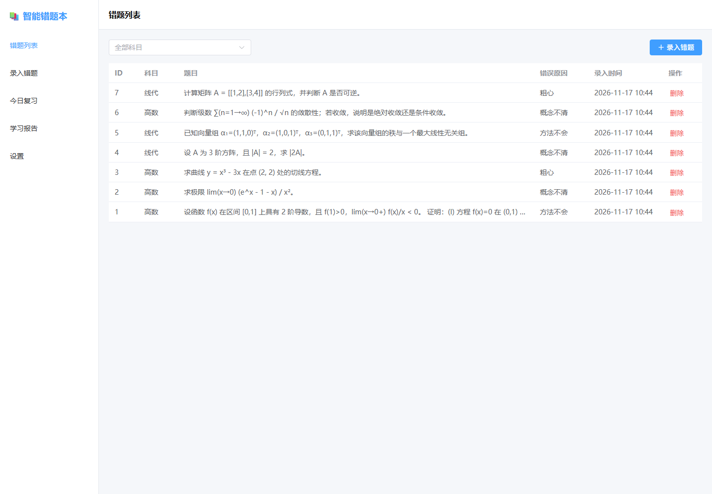
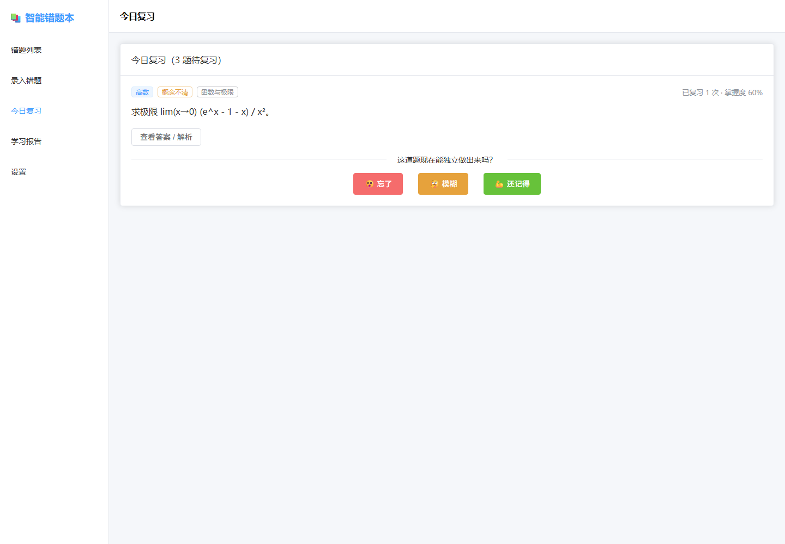
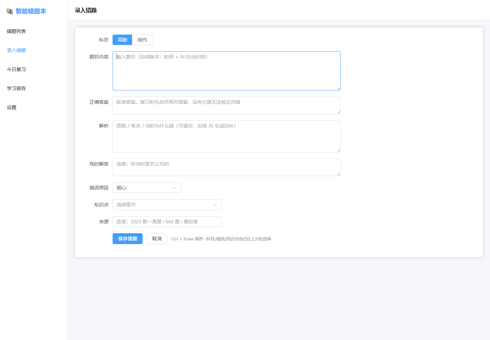
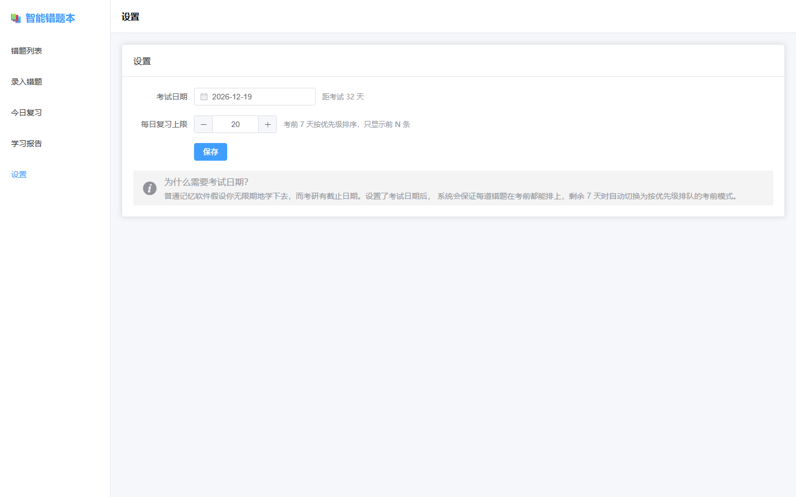
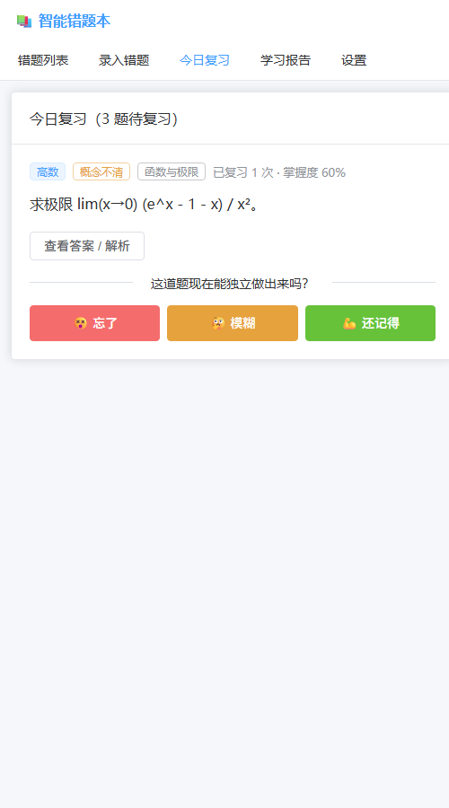

# 考研智能错题本系统（wrongbook）

面向考研复习的**错题管理 + 复习调度**系统。核心解决两个问题：错题记下来却没人复习；通用记忆软件按记忆强度排期，却不知道你哪天考试。

> 本科毕业设计工程实现部分 · 2027 届
> 作者本人正在备考，系统在 2026 年 12 月冲刺期实际使用。

技术栈：FastAPI + SQLAlchemy（SQLite / MySQL）+ Vue 3 + Element Plus + ECharts（规划中）+ 多模态大模型（规划中）

---

## 界面预览

| 错题列表 | 今日复习 |
|---|---|
|  |  |

| 录入错题 | 设置（考试倒计时） |
|---|---|
|  |  |

窄屏（手机 / 平板）下侧边栏收起为顶部导航：



---

## 解决什么问题

| 痛点 | 做法 |
|---|---|
| 错题只记不复习，考前还是不会 | 三档自评 + SM-2 自动排期，到期自动进队列 |
| 记忆软件把题排到考试之后，间隔直接失效 | 引入考试日期，间隔被剩余天数截断，考前 7 天切换为按优先级排队 |
| 不知道自己哪里弱 | 错因分类、知识点、掌握度、复习流水全部落库 |
| 复习时只看题干，无法验证对错 | 正确答案与解析独立字段，先自评再对答案 |

## 核心设计

### 1. 修正版 SM-2

教科书 SM-2 直接照搬会出问题，本项目做了四处修正：

| 规则 | 取值 | 原因 |
|---|---|---|
| 首次 / 第二次间隔 | 1 / 6 天 | SM-2 原值 |
| 后续间隔 | 上次间隔 × EF | SM-2 原值 |
| 失败处理 | 计数归零、间隔回 1 天、EF 扣 0.15–0.3 | 原实现不清零，实测“忘了之后再答对”会直接跳到 30 天 |
| 间隔上限 | 180 天 | 原实现无上限，n=20 时算出 3800 万天 |
| EF 范围 | 1.3 – 2.8 | 下限取自 SM-2，上限防指数爆炸 |

### 2. 考试倒计时约束

通用记忆软件假设学习者无限期地学下去，而考研有明确的截止日期。

```
基础间隔 d₀ = SM-2(n, EF, q)
剩余天数 R  = 考试日期 − 今天
最终间隔 d  = min(d₀, R − 3)          # 考前预留 3 天
若 R ≤ 7：进入考前模式，d = 1，队列按优先级排序
```

考前优先级 = `0.5 × 错因权重 + 0.3 × (1 − 掌握度) + 0.2 × 历史遗忘比例`

### 3. 错因难度先验

同样是错题，粗心（手滑）和概念不清（根上不会）的遗忘速度不一样，不该共用一个初始 EF：

| 错因 | 初始 EF | 失败惩罚 |
|---|---|---|
| 粗心 | 2.7 | 0.15 |
| 方法不会 | 2.4 | 0.20 |
| 概念不清 | 2.1 | 0.30 |

### 4. 数据模型：状态与流水分离

- `review_states`：每道题的当前调度状态（n、EF、间隔、到期日、失败次数）
- `review_logs`：每复习一次写一条流水（质量、前后间隔、EF、是否失败、耗时）

拆开的原因很直接：状态表会被覆盖，历史留不下来；而“掌握度曲线”“间隔预测误差”“调度策略对比”都需要历史流水。

---

## 功能清单

**已实现**

- 错题录入：科目、题干、**正确答案**、解析、我的作答、错因、知识点、来源
- 错题列表：科目筛选、分页、删除（级联清理状态与流水）
- 今日复习：先回忆 → 查看答案与解析 → 三档自评 → 自动排下次日期
- 复习调度：修正版 SM-2 + 考试倒计时 + 考前优先级
- 设置：考试日期、每日复习上限、距考天数
- 知识点目录：高数 12 章 + 线代 5 章
- 窄屏适配、统一错误提示、参数校验、SQLite 外键约束
- 单元测试 15 条、端到端冒烟测试、数据库自动备份

**规划中**

- 拍照 + 多模态识别题目（字段与依赖已就绪）
- AI 生成考点 / 错因 / 通用解法、同类变式题
- 学习报告（ECharts）：知识点分布、错因占比、掌握度曲线
- 用户登录与多用户隔离
- 调度策略对比实验（模拟器 + 真实使用数据）

---

## 快速开始

### 方式一：单端口（推荐，手机也能用）

```bash
cd frontend && npm install && npm run build   # 只需构建一次
cd ../backend && uv sync && uv run python -m app.init_db
cd .. && ./启动.bat                            # Windows 双击也可
```

浏览器打开 `http://127.0.0.1:8000`。启动脚本会打印局域网地址，手机连同一 WiFi 即可访问。

### 方式二：前后端分离（开发模式）

```bash
cd backend && uv run uvicorn app.main:app --reload       # 8000
cd frontend && npm run dev                               # 5173，/api 代理到 8000
```

接口文档：`http://127.0.0.1:8000/docs`

### 测试

```bash
cd backend
uv run python -m unittest discover -s tests -v          # 15 条算法单测
uv run uvicorn app.main:app --port 8123                 # 终端 1
uv run python scripts/smoke_test.py                     # 终端 2，17 项端到端
```

### 备份

```bash
cd backend && uv run python scripts/backup_db.py
```

输出到 `backend/data/backups/`，保留最近 14 份。`启动.bat` 每次启动会自动备份一次。

---

## 目录结构

```
wrongbook/
├── backend/
│   ├── app/
│   │   ├── main.py              # 入口：CORS、SPA 托管（含路径边界检查）
│   │   ├── init_db.py           # 建表 + 种子数据（幂等）
│   │   ├── core/                # 配置、常量
│   │   ├── db/                  # 引擎与会话（SQLite 开启外键）
│   │   ├── models/              # users / knowledge_points / mistakes / review_states / review_logs
│   │   ├── schemas/             # Pydantic 校验
│   │   ├── services/sm2.py      # ★ 调度算法
│   │   └── api/routes.py        # 接口
│   ├── scripts/                 # 冒烟测试、备份
│   └── tests/test_sm2.py        # 算法单测
├── frontend/                    # Vue 3 + Vite + Element Plus
│   └── src/{api,router,views}/
├── docs/
│   ├── 项目进展.md               # 一页纸进展说明（给指导老师）
│   └── screenshots/
└── start.ps1 / 启动.bat
```

## 接口一览

| 方法 | 路径 | 说明 |
|---|---|---|
| POST | `/api/v1/mistakes` | 录入错题（同时建调度状态） |
| GET | `/api/v1/mistakes` | 列表（subject / limit / offset） |
| GET | `/api/v1/mistakes/{id}` | 详情 |
| PUT | `/api/v1/mistakes/{id}` | 更新（必填字段不可置空） |
| DELETE | `/api/v1/mistakes/{id}` | 删除（级联） |
| POST | `/api/v1/reviews` | 提交复习反馈，返回新调度结果 |
| GET | `/api/v1/reviews/due` | 今日队列（题干 + 答案 + 掌握度） |
| GET/PUT | `/api/v1/settings` | 考试日期、每日上限 |
| GET | `/api/v1/knowledge-points` | 知识点目录 |
| GET | `/health` | 健康检查 |

## 已知限制

- 单用户、无登录（`user_id` 未做越权校验，多用户前必须补）
- 无数据库迁移（Alembic 待接入），字段变更需重建库
- 每日复习上限只影响队列展示，不是硬性截止
- 学习报告仍是占位页；拍照识别未实现

## 文档

- [项目进展说明](docs/项目进展.md)：课题定位、已完成工作、后续计划、待讨论问题
